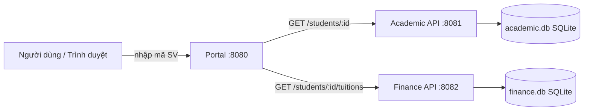
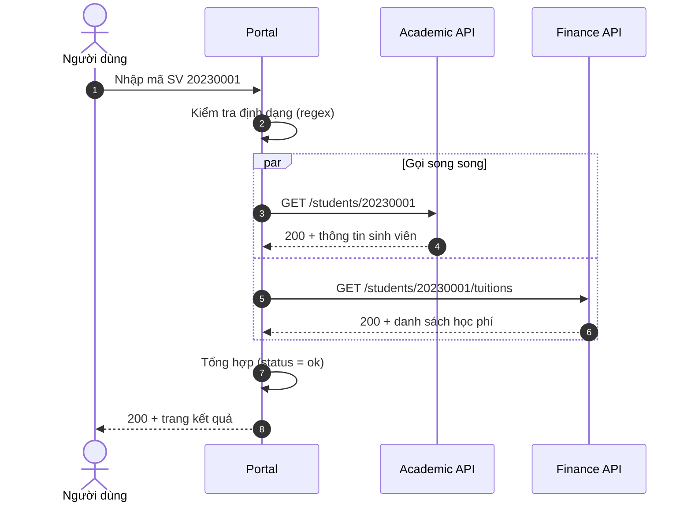
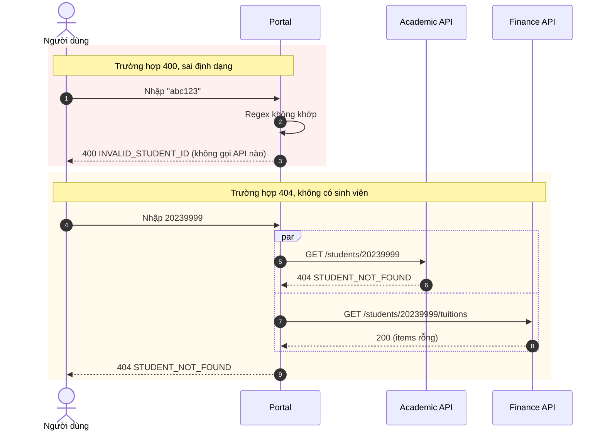
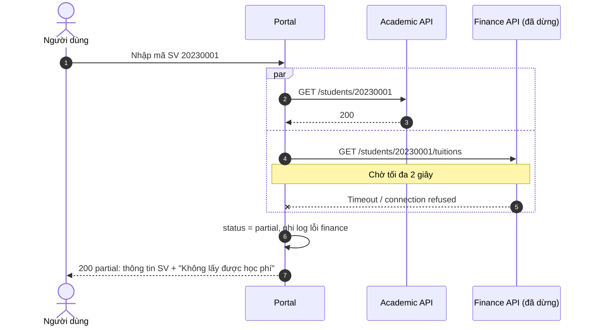

# Chủ đề 04. Tích hợp ứng dụng thông qua REST API và cổng thông tin Portal

## Phần A. Đề bài

### 1. Mục tiêu và kiến thức cần trình bày

- Application Interface Integration
- REST API
- JSON
- HTTP Methods
- Endpoint
- Request/Response
- Mã trạng thái HTTP
- Phân biệt tích hợp thông qua API, truy cập trực tiếp cơ sở dữ liệu và tích hợp hiển thị tại Portal.

### 2. Bài toán và yêu cầu thực hiện

Xây dựng **Academic API** cung cấp thông tin sinh viên, **Finance API** cung cấp khoản học phí và một **Portal** đơn giản. Khi người dùng nhập mã sinh viên, Portal sử dụng API để lấy thông tin từ hai dịch vụ và hiển thị kết quả tổng hợp. Thực hiện kiểm tra đầu vào và xử lý lỗi khi một API không phản hồi.

### 3. Sản phẩm và kết quả cần đạt

- Có tối thiểu **ba API endpoint** với chức năng rõ ràng.
- Sử dụng **Postman** để trình diễn request/response và các trường hợp:
  - Thành công
  - Không tìm thấy dữ liệu
  - Dữ liệu đầu vào không hợp lệ
- Cung cấp **sơ đồ luồng yêu cầu**.

---

## Phần B. Mở rộng: Thiết kế hệ thống dự kiến

> Môn: Tích hợp hệ thống
> Nội dung: Academic API + Finance API + Portal tổng hợp thông tin sinh viên
> Công nghệ đề xuất: Go (Gin), SQLite (mỗi dịch vụ một file DB riêng), Docker Compose, Postman/Newman
> Phạm vi triển khai: **đúng 3 dịch vụ** (Academic, Finance, Portal), không thêm gateway, message broker hay cache server riêng

---

### 1. Tóm tắt

Báo cáo xây dựng một hệ thống gồm ba thành phần độc lập:

- **Academic API** cung cấp thông tin sinh viên.
- **Finance API** cung cấp các khoản học phí.
- **Portal** nhận mã sinh viên từ người dùng, gọi song song hai API, tổng hợp và hiển thị kết quả.

Hệ thống có kiểm tra đầu vào, xử lý lỗi khi một API không phản hồi (trả kết quả một phần thay vì sập toàn bộ), có bộ kiểm thử Postman cho ba nhóm tình huống (thành công, không tìm thấy, đầu vào không hợp lệ) cùng tình huống lỗi hạ tầng, và có sơ đồ luồng yêu cầu. Báo cáo cũng so sánh ba cách tích hợp: qua API, truy cập trực tiếp cơ sở dữ liệu và tích hợp hiển thị tại Portal.

---

### 2. Mục tiêu

| # | Mục tiêu | Cách chứng minh |
|---|----------|-----------------|
| 1 | Hiểu và trình bày Application Interface Integration, REST, JSON, HTTP method, endpoint, request/response, mã trạng thái | Mục 3 |
| 2 | Phân biệt ba cách tích hợp | Mục 4 và thí nghiệm ở mục 10 |
| 3 | Xây dựng ít nhất 3 endpoint có chức năng rõ ràng | Mục 6 (thực hiện 7 endpoint) |
| 4 | Portal tổng hợp dữ liệu từ hai dịch vụ | Mục 7, 8 |
| 5 | Kiểm tra đầu vào, xử lý lỗi khi một API không phản hồi | Mục 8.3, 8.4 |
| 6 | Trình diễn bằng Postman | Mục 9 |
| 7 | Có sơ đồ luồng yêu cầu | Mục 7 |

---

### 3. Cơ sở lý thuyết

#### 3.1. Application Interface Integration

Tích hợp qua giao diện ứng dụng là cách các hệ thống trao đổi dữ liệu và chức năng thông qua **giao diện (interface) được công bố**, thay vì chạm vào nội bộ của nhau. Mỗi hệ thống giữ quyền kiểm soát dữ liệu và nghiệp vụ của mình, chỉ mở ra những gì cần thiết qua một **hợp đồng (contract)** rõ ràng.

Lợi ích chính:

- **Liên kết lỏng (loose coupling)**: thay đổi bên trong một hệ thống không làm hỏng hệ thống khác, miễn hợp đồng giữ nguyên.
- **Đóng gói nghiệp vụ**: quy tắc kiểm tra, phân quyền nằm ở hệ thống sở hữu dữ liệu.
- **Dễ mở rộng và thay thế**: có thể thay một dịch vụ bằng dịch vụ khác cùng hợp đồng.

#### 3.2. REST API

REST (Representational State Transfer) là phong cách kiến trúc cho API trên nền HTTP, với các nguyên tắc:

- **Tài nguyên (resource)** được định danh bằng URI, ví dụ `/students/20230001`.
- **Giao diện thống nhất**: dùng các phương thức HTTP chuẩn để thao tác trên tài nguyên.
- **Phi trạng thái (stateless)**: mỗi request mang đủ thông tin, server không lưu ngữ cảnh phiên giữa các request.
- **Biểu diễn (representation)**: tài nguyên được trao đổi dưới dạng JSON, XML...
- **Client – Server tách biệt**, có thể có tầng trung gian (gateway, cache).

#### 3.3. JSON

JSON (JavaScript Object Notation) là định dạng văn bản nhẹ, dễ đọc, hỗ trợ kiểu: object, array, string, number, boolean, null. Là định dạng trao đổi phổ biến nhất của REST API vì gọn hơn XML và phân tích nhanh.

```json
{
  "studentId": "20230001",
  "fullName": "Nguyễn Văn A",
  "major": "Hệ thống thông tin"
}
```

#### 3.4. Endpoint, Request, Response

- **Endpoint**: địa chỉ cụ thể để gọi một chức năng = phương thức HTTP + URL, ví dụ `GET /api/v1/students/20230001`.
- **Request** gồm: dòng yêu cầu (method, URL), header (`Accept`, `Content-Type`, `X-Request-ID`...), tham số (path, query) và body (với POST/PUT).
- **Response** gồm: mã trạng thái, header, body.

#### 3.5. HTTP Methods

| Method | Ý nghĩa | An toàn (safe) | Idempotent | Ví dụ trong bài |
|--------|---------|:--:|:--:|-----------------|
| GET | Lấy tài nguyên | Có | Có | Lấy thông tin sinh viên |
| POST | Tạo tài nguyên / thực hiện hành động | Không | Không* | Ghi nhận thanh toán |
| PUT | Thay thế toàn bộ tài nguyên | Không | Có | Cập nhật toàn bộ hồ sơ |
| PATCH | Cập nhật một phần | Không | Không bắt buộc | Đổi số điện thoại |
| DELETE | Xóa tài nguyên | Không | Có | Hủy khoản phí nháp |

\* POST mặc định không idempotent. Có thể làm nó idempotent bằng header `Idempotency-Key` (xem mục 8.6).

#### 3.6. Mã trạng thái HTTP

| Nhóm | Mã | Ý nghĩa | Dùng trong bài khi |
|------|----|---------|--------------------|
| 2xx | 200 OK | Thành công | Lấy dữ liệu thành công (kể cả kết quả một phần, có cờ `partial`) |
| 2xx | 201 Created | Tạo thành công | POST thanh toán lần đầu |
| 4xx | 400 Bad Request | Yêu cầu sai | Mã sinh viên sai định dạng |
| 4xx | 401 / 403 | Chưa xác thực / không đủ quyền | Mở rộng bảo mật |
| 4xx | 404 Not Found | Không có tài nguyên | Không tìm thấy sinh viên |
| 4xx | 409 Conflict | Xung đột trạng thái | Khoản học phí đã thanh toán |
| 4xx | 429 Too Many Requests | Quá giới hạn | Mở rộng rate limit |
| 5xx | 500 Internal Server Error | Lỗi nội bộ | Lỗi không lường trước |
| 5xx | 502 Bad Gateway | Upstream trả phản hồi không hợp lệ | API con trả lỗi 5xx hoặc dữ liệu hỏng |
| 5xx | 503 Service Unavailable | Dịch vụ tạm thời không dùng được | Academic không kết nối được |
| 5xx | 504 Gateway Timeout | Upstream không phản hồi kịp | Quá thời gian chờ |

---

### 4. So sánh ba cách tích hợp

#### 4.1. Ba cách tiếp cận

1. **Tích hợp qua API**: Portal gọi Academic API và Finance API qua HTTP.
2. **Truy cập trực tiếp cơ sở dữ liệu**: Portal kết nối thẳng vào DB của Academic và Finance, tự viết truy vấn SQL.
3. **Tích hợp hiển thị tại Portal (presentation integration)**: Portal nhúng giao diện sẵn có của hệ thống khác (iframe, widget, liên kết, micro-frontend).

#### 4.2. Bảng so sánh

| Tiêu chí | Qua API | Truy cập trực tiếp DB | Tích hợp hiển thị Portal |
|----------|---------|----------------------|--------------------------|
| Tầng tích hợp | Tầng dịch vụ / ứng dụng | Tầng dữ liệu | Tầng giao diện |
| Độ gắn kết | Lỏng, qua hợp đồng | Rất chặt, phụ thuộc schema | Lỏng ở dữ liệu, chặt ở giao diện |
| Khi schema thay đổi | Không ảnh hưởng nếu hợp đồng giữ nguyên | Vỡ ngay (đổi/xóa cột, bảng) | Không ảnh hưởng dữ liệu, có thể vỡ giao diện |
| Bảo mật | Tốt: kiểm soát quyền, che trường nhạy cảm | Kém: lộ toàn bộ bảng, cần cấp quyền DB | Phụ thuộc hệ thống nguồn, rủi ro clickjacking |
| Quy tắc nghiệp vụ | Được áp dụng (validate, tính toán) | Bị bỏ qua, dễ đọc dữ liệu sai ngữ cảnh | Giữ nguyên ở hệ thống nguồn |
| Khả năng tổng hợp, biến đổi dữ liệu | Tốt | Tốt về kỹ thuật nhưng rủi ro | Hạn chế, chỉ "ghép" màn hình |
| Hiệu năng | Có độ trễ mạng, cache được | Nhanh nhất | Tải nhiều trang, nặng |
| Khả năng mở rộng | Tốt, mỗi dịch vụ scale riêng | Kém, DB thành điểm nghẽn chung | Trung bình |
| Công sức triển khai | Trung bình | Thấp ban đầu, chi phí bảo trì cao | Thấp nhất |
| Khi nào nên dùng | Mặc định cho tích hợp hệ thống | Gần như không (trừ báo cáo/ETL có kiểm soát) | Cần ghép nhanh giao diện, ít xử lý dữ liệu |

#### 4.3. Kết luận so sánh

Tích hợp qua API cân bằng tốt nhất giữa độ linh hoạt, bảo mật và khả năng bảo trì, nên được chọn làm giải pháp chính của bài. Truy cập trực tiếp DB chỉ nhanh lúc đầu nhưng tạo ra liên kết ngầm khó phát hiện. Tích hợp hiển thị phù hợp khi chỉ cần "ghép" giao diện chứ không cần xử lý dữ liệu. Phần thí nghiệm ở mục 10 chứng minh điều này bằng số liệu thực tế.

---

### 5. Phân tích bài toán và kiến trúc

#### 5.1. Yêu cầu chức năng

- **FR1**: Người dùng nhập mã sinh viên trên Portal.
- **FR2**: Portal kiểm tra định dạng mã sinh viên trước khi gọi API.
- **FR3**: Portal gọi Academic API (thông tin sinh viên) và Finance API (học phí), tổng hợp rồi hiển thị.
- **FR4**: Khi mã không tồn tại, hiển thị thông báo rõ ràng.
- **FR5**: Khi một API không phản hồi, Portal vẫn hiển thị phần dữ liệu còn lại và báo lỗi phần bị thiếu.

#### 5.2. Yêu cầu phi chức năng

- Thời gian chờ mỗi API tối đa 2 giây.
- Phản hồi lỗi thống nhất dạng JSON, có `requestId` để truy vết.
- Mỗi dịch vụ độc lập về mã nguồn, dữ liệu và tiến trình.
- Tổng số đơn vị triển khai là **3** (3 container). Cơ sở dữ liệu là file SQLite nằm trong volume riêng của từng dịch vụ, nên không phát sinh thêm container DB.
- Chạy toàn bộ hệ thống bằng một lệnh `docker compose up`.

#### 5.3. Kiến trúc tổng thể



Nguyên tắc then chốt: **mỗi dịch vụ sở hữu cơ sở dữ liệu riêng (database-per-service)**; Portal không có thông tin kết nối tới DB nào. Đây là điều kiện để hệ thống thực sự "tích hợp qua API".

#### 5.4. Mô hình dữ liệu

**Academic DB, bảng `students`**

| Cột | Kiểu | Ghi chú |
|-----|------|---------|
| student_id | varchar(10) PK | Mã sinh viên |
| full_name | varchar(100) | Họ tên |
| date_of_birth | date | Ngày sinh |
| major | varchar(100) | Ngành |
| class_name | varchar(30) | Lớp |
| cohort | int | Khóa |
| email | varchar(100) | Email |
| status | varchar(20) | studying, suspended, graduated |

**Finance DB, bảng `tuitions`**

| Cột | Kiểu | Ghi chú |
|-----|------|---------|
| id | serial PK | Mã khoản phí |
| student_id | varchar(10) | Tham chiếu logic (không có khóa ngoại sang DB khác) |
| semester | varchar(20) | Học kỳ |
| amount | bigint | Số tiền phải đóng (VND) |
| paid | bigint | Đã đóng |
| due_date | date | Hạn nộp |
| status | varchar(20) | unpaid, partial, paid, overdue |

**Finance DB, bảng `payments`**: `id`, `tuition_id`, `amount`, `method`, `idempotency_key` (unique), `created_at`.

> Kiểu dữ liệu ghi theo dạng SQL thông thường; SQLite tự ánh xạ sang kiểu của nó. Script đầy đủ ở Phụ lục A.

> Lưu ý: `student_id` trong Finance chỉ là **tham chiếu logic**, không phải khóa ngoại thật. Vì hai DB tách biệt nên tính toàn vẹn giữa chúng được bảo đảm ở tầng ứng dụng, đây là một đánh đổi cần nêu rõ khi bảo vệ.

#### 5.5. Triển khai (đúng 3 dịch vụ)

| Dịch vụ | Container | Dữ liệu | Truy cập từ ngoài |
|---------|-----------|---------|-------------------|
| Portal | `portal` | Không có DB | **Công khai** (cổng 8080) |
| Academic API | `academic-api` | `academic.db` trong volume `academic-data` | Chỉ mở cổng khi chạy demo Postman cục bộ |
| Finance API | `finance-api` | `finance.db` trong volume `finance-data` | Chỉ mở cổng khi chạy demo Postman cục bộ |

Hai chế độ chạy cùng một `docker-compose.yml`:

- **Chế độ demo cục bộ** (`docker compose up`): mở cả ba cổng 8080, 8081, 8082 để Postman gọi trực tiếp từng API và demo dừng Finance.
- **Chế độ triển khai** (`docker compose -f docker-compose.yml -f docker-compose.deploy.yml up -d`): chỉ Portal publish cổng; hai API chỉ nằm trong mạng nội bộ của Compose. Đây cũng là điểm bảo mật cần nêu: người dùng ngoài chỉ chạm Portal, không gọi thẳng được API nội bộ.

Có thể triển khai lên một VPS hoặc máy chủ của trường bằng đúng hai file Compose này. Nếu cần HTTPS, đặt TLS ở lớp hạ tầng (nhà cung cấp hoặc reverse proxy sẵn có của máy chủ), không tính là dịch vụ của bài.

Lựa chọn SQLite là đánh đổi có chủ đích: bài chỉ cần chứng minh nguyên tắc "mỗi dịch vụ một kho dữ liệu riêng", còn việc đổi sang PostgreSQL khi cần tải thực chỉ là đổi driver và chuỗi kết nối, hợp đồng API không đổi.

---

### 6. Thiết kế API

Tiền tố chung: `/api/v1`. Toàn bộ dùng JSON, mã hóa UTF-8.

#### 6.1. Danh sách endpoint

| # | Dịch vụ | Method | Endpoint | Chức năng | Mã trả về |
|---|---------|--------|----------|-----------|-----------|
| 1 | Academic | GET | `/api/v1/students/{id}` | Lấy thông tin sinh viên | 200, 400, 404 |
| 2 | Academic | GET | `/health` | Kiểm tra sống | 200 |
| 3 | Finance | GET | `/api/v1/students/{id}/tuitions` | Danh sách học phí của sinh viên | 200, 400 |
| 4 | Finance | POST | `/api/v1/tuitions/{tuitionId}/payments` | Ghi nhận thanh toán | 201, 400, 404, 409 |
| 5 | Finance | GET | `/health` | Kiểm tra sống | 200 |
| 6 | Portal | GET | `/api/v1/portal/students/{id}/summary` | Tổng hợp thông tin + học phí | 200, 400, 404, 503 |
| 7 | Portal | GET | `/` | Trang giao diện nhập mã SV | 200 |

> Quy ước: Finance trả **200 với mảng rỗng** khi sinh viên chưa có khoản phí nào (hợp lệ), còn Academic trả **404** khi không có sinh viên. Phân biệt "không có dữ liệu con" với "không có tài nguyên cha" là điểm cần giải thích khi bảo vệ.

#### 6.2. Định dạng phản hồi

**Thành công, Academic `GET /api/v1/students/20230001` → 200**

```json
{
  "studentId": "20230001",
  "fullName": "Nguyễn Văn A",
  "dateOfBirth": "2005-03-14",
  "major": "Hệ thống thông tin",
  "className": "CCHT-K2023",
  "cohort": 2023,
  "email": "a.nv@example.edu.vn",
  "status": "studying"
}
```

**Thành công, Finance `GET /api/v1/students/20230001/tuitions` → 200**

```json
{
  "studentId": "20230001",
  "currency": "VND",
  "items": [
    { "id": 11, "semester": "2026-1", "amount": 18500000, "paid": 18500000,
      "dueDate": "2026-09-30", "status": "paid" },
    { "id": 12, "semester": "2026-2", "amount": 18500000, "paid": 5000000,
      "dueDate": "2027-02-28", "status": "partial" }
  ],
  "totalDue": 13500000
}
```

**Portal tổng hợp, đủ dữ liệu → 200**

```json
{
  "status": "ok",
  "student": { "studentId": "20230001", "fullName": "Nguyễn Văn A", "major": "Hệ thống thông tin" },
  "tuitions": { "currency": "VND", "totalDue": 13500000, "items": [ ... ] },
  "errors": [],
  "requestId": "7f3c1a2e-9b4d-4e0a-8f11-2c5d6a7b8c90"
}
```

**Portal tổng hợp, Finance không phản hồi → 200 (một phần)**

```json
{
  "status": "partial",
  "student": { "studentId": "20230001", "fullName": "Nguyễn Văn A", "major": "Hệ thống thông tin" },
  "tuitions": null,
  "errors": [
    { "source": "finance", "code": "UPSTREAM_TIMEOUT",
      "message": "Không lấy được thông tin học phí, vui lòng thử lại sau." }
  ],
  "requestId": "7f3c1a2e-9b4d-4e0a-8f11-2c5d6a7b8c90"
}
```

**Lỗi chuẩn hóa (mọi dịch vụ dùng chung)**

```json
{
  "error": {
    "code": "STUDENT_NOT_FOUND",
    "message": "Không tìm thấy sinh viên với mã 20239999",
    "requestId": "7f3c1a2e-9b4d-4e0a-8f11-2c5d6a7b8c90"
  }
}
```

#### 6.3. Bảng mã lỗi nghiệp vụ

| code | HTTP | Khi nào |
|------|------|---------|
| INVALID_STUDENT_ID | 400 | Mã không khớp `^\d{8,10}$` |
| STUDENT_NOT_FOUND | 404 | Academic không có sinh viên |
| TUITION_NOT_FOUND | 404 | Khoản phí không tồn tại |
| TUITION_ALREADY_PAID | 409 | Khoản phí đã thanh toán đủ |
| INVALID_PAYMENT_AMOUNT | 400 | Số tiền ≤ 0 hoặc vượt số còn nợ |
| UPSTREAM_TIMEOUT | 504 / trong `errors` | API con không phản hồi kịp |
| UPSTREAM_UNAVAILABLE | 503 / trong `errors` | Không kết nối được API con |
| UPSTREAM_BAD_RESPONSE | 502 / trong `errors` | API con trả dữ liệu hỏng hoặc 5xx |
| INTERNAL_ERROR | 500 | Lỗi không lường trước |

---

### 7. Sơ đồ luồng yêu cầu

#### 7.1. Luồng thành công



#### 7.2. Luồng đầu vào không hợp lệ (400) và không tìm thấy (404)



#### 7.3. Luồng Finance không phản hồi (partial response)



#### 7.4. Bảng quyết định tổng hợp kết quả

| Academic | Finance | Portal trả về | Ghi chú |
|----------|---------|---------------|---------|
| OK | OK | 200, `status: ok` | Đầy đủ |
| OK | Lỗi / timeout | 200, `status: partial` | Hiển thị SV, báo thiếu học phí |
| 404 | (bỏ qua) | 404 | Sinh viên không tồn tại |
| Lỗi / timeout | OK | 503 | Thiếu dữ liệu cốt lõi, không có thông tin định danh để hiển thị |
| Lỗi / timeout | Lỗi / timeout | 503 | Cả hai đều hỏng |

Quy tắc: **Academic là dữ liệu cốt lõi** (xác định sinh viên có tồn tại), **Finance là dữ liệu bổ sung** nên được phép thiếu. Quyết định này phản ánh ưu tiên nghiệp vụ và cần được nêu rõ khi bảo vệ.

---

### 8. Cài đặt

#### 8.1. Cấu trúc thư mục

```
integration-portal/
├── docker-compose.yml            # demo cục bộ, mở cả 3 cổng
├── docker-compose.deploy.yml     # triển khai, chỉ Portal công khai
├── academic-api/
│   ├── main.go
│   ├── handler.go
│   ├── repository.go
│   ├── seed.sql
│   └── Dockerfile
├── finance-api/
│   ├── main.go
│   ├── handler.go
│   ├── repository.go
│   ├── seed.sql
│   └── Dockerfile
├── portal/
│   ├── main.go
│   ├── aggregator.go
│   ├── clients.go
│   ├── static/index.html
│   └── Dockerfile
├── shared/                  # middleware request-id, định dạng lỗi
├── postman/
│   ├── collection.json
│   └── environment.json
├── openapi/
│   ├── academic.yaml
│   └── finance.yaml
└── docs/
```

#### 8.2. Docker Compose (rút gọn)

`docker-compose.yml` (chế độ demo cục bộ, đúng 3 service):

```yaml
services:
  academic-api:
    build: ./academic-api
    environment:
      DB_PATH: /data/academic.db
      SEED_FILE: /app/seed.sql        # tự chạy khi file DB chưa tồn tại
    volumes: [ "academic-data:/data" ]
    ports: [ "8081:8081" ]
    healthcheck:
      test: [ "CMD", "wget", "-qO-", "http://localhost:8081/health" ]
      interval: 5s
      retries: 5

  finance-api:
    build: ./finance-api
    environment:
      DB_PATH: /data/finance.db
      SEED_FILE: /app/seed.sql
    volumes: [ "finance-data:/data" ]
    ports: [ "8082:8082" ]
    healthcheck:
      test: [ "CMD", "wget", "-qO-", "http://localhost:8082/health" ]
      interval: 5s
      retries: 5

  portal:
    build: ./portal
    environment:
      ACADEMIC_URL: http://academic-api:8081
      FINANCE_URL: http://finance-api:8082
      UPSTREAM_TIMEOUT: 2s
    ports: [ "8080:8080" ]
    depends_on:
      academic-api: { condition: service_started }   # không dùng service_healthy để vẫn demo được khi API chết
      finance-api:  { condition: service_started }

volumes:
  academic-data:
  finance-data:
```

`docker-compose.deploy.yml` (ghi đè khi triển khai, chỉ Portal công khai):

```yaml
services:
  academic-api:
    ports: !reset []
    restart: unless-stopped
  finance-api:
    ports: !reset []
    restart: unless-stopped
  portal:
    restart: unless-stopped
```

Portal **chỉ biết URL của hai API**, không có biến môi trường nào trỏ tới file DB. Có thể dùng điều này để chứng minh nguyên tắc tích hợp.

> Lưu ý kỹ thuật: dùng driver SQLite thuần Go (ví dụ `modernc.org/sqlite`) để build `CGO_ENABLED=0`, image nhỏ và không cần thư viện C.

#### 8.3. Kiểm tra đầu vào

```go
var studentIDRe = regexp.MustCompile(`^\d{8,10}$`)

func validateStudentID(id string) error {
    id = strings.TrimSpace(id)
    if !studentIDRe.MatchString(id) {
        return &APIError{
            Status:  http.StatusBadRequest,
            Code:    "INVALID_STUDENT_ID",
            Message: "Mã sinh viên phải gồm 8 đến 10 chữ số",
        }
    }
    return nil
}
```

Kiểm tra ở **hai lớp**: giao diện (HTML pattern, phản hồi nhanh cho người dùng) và backend (bắt buộc, vì không thể tin client). Cả Academic và Finance cũng tự kiểm tra lại, vì chúng có thể được gọi trực tiếp, không chỉ qua Portal.

#### 8.4. Client gọi API con và phân loại lỗi

```go
type UpstreamError struct {
    Source string // "academic" | "finance"
    Code   string // NOT_FOUND | TIMEOUT | UNAVAILABLE | BAD_RESPONSE
    Err    error
}

func (c *Client) get(ctx context.Context, source, url, reqID string, out any) error {
    req, _ := http.NewRequestWithContext(ctx, http.MethodGet, url, nil)
    req.Header.Set("Accept", "application/json")
    req.Header.Set("X-Request-ID", reqID)

    resp, err := c.http.Do(req)
    if err != nil {
        var ne net.Error
        if errors.Is(err, context.DeadlineExceeded) || (errors.As(err, &ne) && ne.Timeout()) {
            return &UpstreamError{source, "TIMEOUT", err}
        }
        return &UpstreamError{source, "UNAVAILABLE", err}
    }
    defer resp.Body.Close()

    switch {
    case resp.StatusCode == http.StatusNotFound:
        return &UpstreamError{source, "NOT_FOUND", nil}
    case resp.StatusCode >= 500:
        return &UpstreamError{source, "BAD_RESPONSE", fmt.Errorf("status %d", resp.StatusCode)}
    case resp.StatusCode != http.StatusOK:
        return &UpstreamError{source, "BAD_RESPONSE", fmt.Errorf("unexpected %d", resp.StatusCode)}
    }
    if err := json.NewDecoder(resp.Body).Decode(out); err != nil {
        return &UpstreamError{source, "BAD_RESPONSE", err}
    }
    return nil
}
```

#### 8.5. Tổng hợp song song và trả kết quả một phần

```go
func (h *Handler) Summary(c *gin.Context) {
    reqID := requestID(c)
    id := c.Param("id")
    if err := validateStudentID(id); err != nil {
        writeError(c, err, reqID)
        return
    }

    ctx, cancel := context.WithTimeout(c.Request.Context(), h.timeout) // 2s
    defer cancel()

    var (
        wg       sync.WaitGroup
        student  Student
        tuitions TuitionResponse
        aErr, fErr error
    )
    // Dùng WaitGroup thay vì errgroup để lỗi của một bên
    // KHÔNG hủy bên còn lại: ta muốn nhận được kết quả một phần.
    wg.Add(2)
    go func() {
        defer wg.Done()
        aErr = h.academic.GetStudent(ctx, id, reqID, &student)
    }()
    go func() {
        defer wg.Done()
        fErr = h.finance.GetTuitions(ctx, id, reqID, &tuitions)
    }()
    wg.Wait()

    // 1) Academic là dữ liệu cốt lõi
    if aErr != nil {
        var ue *UpstreamError
        if errors.As(aErr, &ue) && ue.Code == "NOT_FOUND" {
            writeJSON(c, 404, apiErr("STUDENT_NOT_FOUND", "Không tìm thấy sinh viên "+id, reqID))
            return
        }
        writeJSON(c, 503, apiErr("UPSTREAM_UNAVAILABLE", "Dịch vụ học vụ tạm thời không khả dụng", reqID))
        return
    }

    // 2) Finance được phép thiếu
    resp := SummaryResponse{Status: "ok", Student: &student, RequestID: reqID}
    if fErr != nil {
        resp.Status = "partial"
        resp.Errors = append(resp.Errors, toPublicError("finance", fErr))
        log.Printf("[%s] finance failed: %v", reqID, fErr)
    } else {
        resp.Tuitions = &tuitions
    }
    c.JSON(http.StatusOK, resp)
}
```

Điểm kỹ thuật cần nhấn mạnh khi bảo vệ:

- Gọi **song song** nên tổng thời gian ≈ max(hai API), không phải tổng.
- `context.WithTimeout` đảm bảo Portal không bị treo khi một API chậm.
- Dùng `WaitGroup` thay vì `errgroup` có chủ đích để một lỗi không hủy luồng còn lại.
- Thông báo lỗi trả cho người dùng là thông điệp thân thiện; chi tiết kỹ thuật chỉ nằm trong log.

#### 8.6. Idempotency cho POST thanh toán

```go
// Finance API: POST /api/v1/tuitions/:id/payments
// Header: Idempotency-Key: <uuid do client sinh>
func (h *Handler) CreatePayment(c *gin.Context) {
    key := c.GetHeader("Idempotency-Key")
    if key == "" {
        writeError(c, badRequest("MISSING_IDEMPOTENCY_KEY", "Thiếu header Idempotency-Key"), reqID(c))
        return
    }
    if prev, ok := h.repo.FindPaymentByKey(key); ok {
        c.JSON(http.StatusOK, prev) // gửi lại cùng key: trả kết quả cũ, không tạo thanh toán mới
        return
    }
    // ... kiểm tra khoản phí, số tiền, trạng thái (404/400/409) rồi tạo payment (201)
}
```

Cột `idempotency_key` có ràng buộc UNIQUE để chống trùng ngay cả khi có hai request đến đồng thời.

#### 8.7. Request ID xuyên suốt

Middleware dùng chung: nếu request đến có `X-Request-ID` thì giữ nguyên, nếu không thì sinh UUID. Portal truyền ID này xuống Academic và Finance, mọi dòng log đều gắn ID. Nhờ đó theo dõi được một yêu cầu đi qua cả ba dịch vụ bằng `grep requestId`.

---

### 9. Kiểm thử bằng Postman

#### 9.1. Tổ chức collection

```
Collection: Integration Portal - Topic 04
├── 01 Success
│   ├── Academic - Get student (200)
│   ├── Finance - Get tuitions (200)
│   ├── Finance - Create payment (201)
│   └── Portal - Summary (200, status=ok)
├── 02 Not Found
│   ├── Academic - Student not found (404)
│   ├── Finance - Tuition not found (404)
│   └── Portal - Summary unknown student (404)
├── 03 Invalid Input
│   ├── Academic - Invalid ID format (400)
│   ├── Portal - Summary invalid ID "abc" (400)
│   ├── Finance - Payment amount <= 0 (400)
│   └── Finance - Payment missing Idempotency-Key (400)
├── 04 Conflict / Idempotency
│   ├── Finance - Pay already paid tuition (409)
│   └── Finance - Replay same Idempotency-Key (200, không tạo mới)
└── 05 Upstream Failure   (chạy sau khi dừng container)
    ├── Portal - Finance down (200, status=partial)
    └── Portal - Academic down (503)
```

Environment: `academicUrl`, `financeUrl`, `portalUrl`, `validId`, `unknownId`, `invalidId`.

#### 9.2. Bảng test case

| ID | Nhóm | Request | Kết quả mong đợi |
|----|------|---------|------------------|
| TC01 | Thành công | `GET {{portalUrl}}/api/v1/portal/students/{{validId}}/summary` | 200, `status=ok`, có `student` và `tuitions` |
| TC02 | Thành công | `GET {{academicUrl}}/api/v1/students/{{validId}}` | 200, đúng schema |
| TC03 | Thành công | `GET {{financeUrl}}/api/v1/students/{{validId}}/tuitions` | 200, `items` là mảng |
| TC04 | Thành công | `POST .../tuitions/12/payments` kèm key mới | 201 |
| TC05 | Không tìm thấy | `GET {{portalUrl}}/.../students/{{unknownId}}/summary` | 404, `error.code=STUDENT_NOT_FOUND` |
| TC06 | Không tìm thấy | `POST .../tuitions/99999/payments` | 404, `TUITION_NOT_FOUND` |
| TC07 | Đầu vào sai | `GET .../students/abc/summary` | 400, `INVALID_STUDENT_ID` |
| TC08 | Đầu vào sai | `GET .../students/123/summary` (quá ngắn) | 400 |
| TC09 | Đầu vào sai | `GET .../students/20230001%27%20OR%201%3D1/summary` (thử chèn SQL) | 400 |
| TC10 | Đầu vào sai | `POST` số tiền âm | 400, `INVALID_PAYMENT_AMOUNT` |
| TC11 | Xung đột | Thanh toán khoản đã đủ | 409, `TUITION_ALREADY_PAID` |
| TC12 | Idempotency | Gửi lại cùng `Idempotency-Key` | 200, trả lại payment cũ, không tạo bản ghi mới |
| TC13 | Lỗi hạ tầng | Dừng Finance → gọi summary | 200, `status=partial`, `errors[0].source=finance` |
| TC14 | Lỗi hạ tầng | Dừng Academic → gọi summary | 503 |
| TC15 | Hiệu năng | Finance chậm 5 giây | Portal trả lời trong khoảng 2 giây (timeout) |

#### 9.3. Test script mẫu

```javascript
// TC01 - Portal summary thành công
pm.test("Status 200", () => pm.response.to.have.status(200));
pm.test("Có header JSON", () =>
  pm.expect(pm.response.headers.get("Content-Type")).to.include("application/json"));

const body = pm.response.json();
pm.test("status = ok", () => pm.expect(body.status).to.eql("ok"));
pm.test("Có thông tin sinh viên", () => {
  pm.expect(body.student).to.have.property("studentId", pm.environment.get("validId"));
  pm.expect(body.student).to.have.property("fullName");
});
pm.test("Có học phí và là mảng", () => pm.expect(body.tuitions.items).to.be.an("array"));
pm.test("Có requestId", () => pm.expect(body.requestId).to.be.a("string").and.not.empty);
pm.test("Phản hồi dưới 2500ms", () => pm.expect(pm.response.responseTime).to.be.below(2500));
```

```javascript
// TC07 - Mã sai định dạng
pm.test("Status 400", () => pm.response.to.have.status(400));
pm.test("Đúng mã lỗi", () =>
  pm.expect(pm.response.json().error.code).to.eql("INVALID_STUDENT_ID"));
```

```javascript
// TC13 - Finance down
pm.test("Vẫn 200", () => pm.response.to.have.status(200));
pm.test("status = partial", () => pm.expect(pm.response.json().status).to.eql("partial"));
pm.test("Có student, không có tuitions", () => {
  const b = pm.response.json();
  pm.expect(b.student).to.be.an("object");
  pm.expect(b.tuitions).to.be.null;
});
pm.test("Lỗi chỉ rõ nguồn finance", () =>
  pm.expect(pm.response.json().errors[0].source).to.eql("finance"));
```

#### 9.4. Chạy tự động bằng Newman

```bash
# Nhóm 01-04 khi hệ thống chạy đủ
newman run postman/collection.json -e postman/environment.json \
  --folder "01 Success" --folder "02 Not Found" \
  --folder "03 Invalid Input" --folder "04 Conflict"

# Nhóm 05 sau khi dừng Finance
docker compose stop finance-api
newman run postman/collection.json -e postman/environment.json --folder "05 Upstream Failure"
docker compose start finance-api
```

#### 9.5. Kịch bản trình diễn

1. `docker compose up` rồi chạy `GET /health` của ba dịch vụ.
2. Chạy folder **Success**: cho thấy Portal tổng hợp từ hai API.
3. Chạy folder **Not Found** và **Invalid Input**: giải thích từng mã 404, 400.
4. `docker compose stop finance-api` rồi gửi lại request: Portal vẫn trả `partial`.
5. Mở giao diện Portal, nhập mã, quan sát thông báo "Không lấy được học phí".
6. Mở log, tìm theo `requestId` để thấy dấu vết xuyên ba dịch vụ.

---

### 10. Thí nghiệm chứng minh: API và truy cập trực tiếp DB

Mục tiêu: chứng minh bằng thực nghiệm lập luận ở mục 4.

**Chuẩn bị:** viết thêm một bản Portal "sai cách" (`portal-direct`) mở thẳng file `academic.db` (mount volume `academic-data`) và đọc bằng câu lệnh `SELECT student_id, full_name, major FROM students WHERE student_id = ?`. Đây chỉ là chương trình chạy tạm để làm thí nghiệm, **không** thuộc hệ thống 3 dịch vụ và không đưa vào bản triển khai.

**Thực hiện:**

| Bước | Thao tác | Portal qua API | Portal đọc DB trực tiếp |
|------|----------|----------------|--------------------------|
| 1 | Hệ thống chạy bình thường | Chạy | Chạy |
| 2 | Academic đổi cột `full_name` thành `name` (bên trong Academic, API vẫn trả `fullName`) | **Vẫn chạy** | **Lỗi 500: no such column: full_name** |
| 3 | Cho Portal truy cập dữ liệu | Không cần | Phải mount cả file DB, đọc được toàn bộ bảng, lộ cột nhạy cảm như `email`, `date_of_birth` |
| 4 | Thêm quy tắc "sinh viên đã nghỉ học không hiển thị" vào Academic | Áp dụng tự động | Portal phải tự viết lại quy tắc, nếu quên sẽ hiển thị sai |

**Kết luận:** liên kết qua DB là liên kết **ngầm**: Academic không biết có ai phụ thuộc vào schema của mình, nên đổi cột là làm sập hệ thống khác mà không có cảnh báo. API biến phụ thuộc đó thành một hợp đồng công khai, có phiên bản (`/v1`), nên có thể thay đổi nội bộ một cách an toàn.

---

### 11. Phần nâng cao (giữ nguyên 3 dịch vụ, không thêm hạ tầng)

Toàn bộ hạng mục dưới đây chạy **bên trong** ba dịch vụ có sẵn hoặc là công cụ kiểm thử bên ngoài, nên không làm tăng số đơn vị triển khai.

#### 11.1. Nên làm (ưu tiên, đã gắn vào kế hoạch ở mục 13)

| Hạng mục | Cách làm trong 3 dịch vụ | Giá trị với bài toán tích hợp |
|----------|--------------------------|-------------------------------|
| **OpenAPI / Swagger** | Viết `openapi/*.yaml` trước, Academic và Finance phục vụ Swagger UI ngay trong process của mình | Hợp đồng là trung tâm của tích hợp qua API |
| **Circuit breaker** | Cài trong Portal (thư viện nhỏ như `sony/gobreaker` hoặc tự viết ~50 dòng), theo dõi riêng từng API con; log chuyển trạng thái closed / open / half-open | Tránh dồn request vào dịch vụ đang chết; demo được khi dừng Finance |
| **Cache trong bộ nhớ (stale-if-error)** | Portal giữ cache in-memory có TTL cho hồ sơ sinh viên và học phí; khi API chết trả dữ liệu cũ kèm `"stale": true` | Tăng độ sẵn sàng, không cần Redis |
| **Retry + backoff + jitter** | Thử lại 1 lần với độ trễ ngẫu nhiên, chỉ với lỗi thoáng qua của GET | Chịu lỗi tạm thời |
| **Xác thực dịch vụ với dịch vụ** | Portal gửi API key hoặc JWT nội bộ, hai API từ chối request không có (401) | Bảo mật tích hợp, tận dụng được cơ chế JWT |
| **Idempotency-Key** | Đã có ở mục 8.6 | POST an toàn khi client gửi lại |

#### 11.2. Công cụ kiểm chứng (chạy ngoài hệ thống)

| Công cụ | Dùng để |
|---------|---------|
| Postman + Newman | Kiểm thử tự động (mục 9) |
| k6 | Đo độ trễ p95 trước và sau khi bật cache |
| `docker compose stop/start` | Chaos demo thủ công: dừng một dịch vụ để chứng minh partial response và circuit breaker |

#### 11.3. Không làm trong phạm vi bài (ghi vào hướng phát triển)

API Gateway, Consul (service discovery), Kafka và outbox, Redis, Keycloak, Jaeger/OpenTelemetry, Kubernetes. Lý do: mỗi thứ là một dịch vụ hạ tầng riêng, vượt giới hạn 3 dịch vụ và làm loãng trọng tâm của đề là tích hợp qua REST API và Portal. Khi bảo vệ, có thể trả lời rằng thiết kế hiện tại đã tách sẵn ranh giới để thêm các thành phần này mà không đổi hợp đồng API.

---

### 12. Đánh giá, hạn chế và hướng phát triển

**Kết quả đạt được**

- Ba thành phần độc lập, giao tiếp qua REST/JSON, không dùng chung DB.
- Bảy endpoint chức năng rõ ràng, thống nhất định dạng phản hồi và lỗi.
- Portal chịu lỗi: kiểm tra đầu vào, timeout, trả kết quả một phần.
- Bộ kiểm thử Postman/Newman bao phủ thành công, không tìm thấy, đầu vào sai, xung đột và lỗi hạ tầng.
- Có thí nghiệm định lượng chứng minh ưu thế của tích hợp qua API.

**Hạn chế**

- Gọi đồng bộ nên độ trễ Portal phụ thuộc dịch vụ chậm nhất.
- Chưa có xác thực giữa các dịch vụ (nếu chưa làm phần mở rộng JWT).
- `student_id` trong Finance là tham chiếu logic nên có thể tồn tại khoản phí mồ côi nếu sinh viên bị xóa ở Academic. Cần cơ chế đối soát hoặc event để đồng bộ.
- Dữ liệu mẫu nhỏ, chưa kiểm thử tải thực tế.

**Hướng phát triển:** thêm API Gateway và service discovery, cache phân tán (Redis), xác thực OAuth2/OIDC, chuyển một số luồng sang bất đồng bộ bằng sự kiện (Kafka, outbox), bổ sung quan sát (trace, metric) và kiểm thử hợp đồng trong CI. Chuyển SQLite sang PostgreSQL khi cần tải thực.

---

### 13. Kế hoạch thực hiện (3 dịch vụ, có triển khai)

Ước lượng cho một người, mỗi buổi khoảng 2 đến 3 giờ. Điều chỉnh theo hạn nộp thực tế.

| Giai đoạn | Việc làm | Sản phẩm kiểm tra được |
|-----------|----------|------------------------|
| 1. Nền tảng | Viết OpenAPI cho Academic và Finance; dựng khung 3 service, middleware `X-Request-ID`, định dạng lỗi chung, SQLite + seed | `GET /health` của cả 3 trả 200 |
| 2. API lõi | Academic `GET /students/{id}`; Finance `GET /students/{id}/tuitions`; kiểm tra đầu vào (400), 404 | Gọi trực tiếp từng API đúng mã trạng thái |
| 3. Portal | Handler tổng hợp song song, timeout 2s, bảng quyết định mục 7.4, giao diện HTML | Nhập mã SV ra kết quả; dừng Finance ra `partial` |
| 4. POST thanh toán | Finance `POST /tuitions/{id}/payments`, 201 / 400 / 404 / 409, Idempotency-Key | Test TC04, TC10 đến TC12 đạt |
| 5. Nâng cao | Circuit breaker, cache stale-if-error, retry, API key giữa dịch vụ | Log chuyển trạng thái breaker; response có `stale` |
| 6. Kiểm thử | Hoàn thiện Postman collection và script, chạy Newman, ghi hình kết quả | Báo cáo Newman, ảnh chụp |
| 7. Thí nghiệm | Dựng `portal-direct` tạm, quay clip đổi schema | Clip 1 phút, bảng đối chiếu mục 10 |
| 8. Triển khai | Viết `docker-compose.deploy.yml`, đưa lên máy chủ/VPS, kiểm tra chỉ Portal truy cập được từ ngoài | Truy cập Portal qua địa chỉ công khai; gọi thẳng API từ ngoài bị từ chối |
| 9. Hoàn thiện | Sơ đồ, báo cáo, slide, tập trả lời câu hỏi (mục 15) | Bộ nộp cuối cùng |

Nguyên tắc cắt giảm khi thiếu thời gian (bỏ từ dưới lên): bỏ giai đoạn 8 → rút gọn giai đoạn 5 còn circuit breaker → rút gọn giai đoạn 7 còn bảng đối chiếu bằng lời. Giai đoạn 1 đến 4 và 6 là phần bắt buộc để đạt đủ yêu cầu của đề.

---

### 14. Đối chiếu với yêu cầu đề bài

| Yêu cầu của đề | Đáp ứng ở |
|----------------|-----------|
| Trình bày Application Interface Integration, REST API, JSON, HTTP Methods, Endpoint, Request/Response, mã trạng thái | Mục 3 |
| Phân biệt API, truy cập trực tiếp DB, tích hợp hiển thị Portal | Mục 4, 10 |
| Academic API cung cấp thông tin sinh viên | Mục 6.1 (#1) |
| Finance API cung cấp khoản học phí | Mục 6.1 (#3, #4) |
| Portal đơn giản, nhập mã sinh viên, gọi hai API, hiển thị tổng hợp | Mục 6.1 (#6, #7), 8.5 |
| Kiểm tra đầu vào | Mục 8.3 |
| Xử lý lỗi khi một API không phản hồi | Mục 7.3, 7.4, 8.4, 8.5 |
| Tối thiểu 3 endpoint rõ ràng | Mục 6.1 (7 endpoint) |
| Postman: thành công, không tìm thấy, đầu vào không hợp lệ | Mục 9 |
| Sơ đồ luồng yêu cầu | Mục 7 |

---

### 15. Gợi ý trình bày (khoảng 10 phút)

| Thời lượng | Nội dung |
|-----------|----------|
| 1 phút | Bài toán và mục tiêu |
| 2 phút | Lý thuyết cô đọng: REST, JSON, method, mã trạng thái |
| 2 phút | So sánh 3 cách tích hợp và thí nghiệm đổi schema |
| 1 phút | Kiến trúc và sơ đồ luồng |
| 3 phút | Demo Postman (4 nhóm) và demo dừng Finance |
| 1 phút | Triển khai (chỉ Portal công khai), phần nâng cao, hạn chế, kết luận |

**Câu hỏi giảng viên có thể hỏi và hướng trả lời**

1. *Vì sao không cho Portal đọc thẳng DB?* → Liên kết ngầm, vỡ khi đổi schema, lộ dữ liệu, bỏ qua nghiệp vụ (xem thí nghiệm mục 10).
2. *Vì sao Finance lỗi vẫn trả 200 mà không trả 5xx?* → Portal vẫn phục vụ được phần cốt lõi; trạng thái `partial` và mảng `errors` cho client biết phần thiếu. Đây là graceful degradation.
3. *Vì sao Academic lỗi lại trả 503?* → Thiếu dữ liệu định danh cốt lõi, không có gì có nghĩa để hiển thị.
4. *Khác nhau giữa 502, 503, 504?* → Xem bảng mục 3.6.
5. *POST có idempotent không?* → Mặc định không; dùng `Idempotency-Key` để an toàn khi client gửi lại.
6. *Tại sao dùng WaitGroup mà không dùng errgroup?* → errgroup hủy context khi một goroutine lỗi, làm mất kết quả bên còn lại, trái mục tiêu trả kết quả một phần.

---

### Phụ lục A. Dữ liệu mẫu

```sql
-- academic-api/seed.sql (SQLite)
CREATE TABLE students (
  student_id VARCHAR(10) PRIMARY KEY,
  full_name VARCHAR(100) NOT NULL,
  date_of_birth DATE,
  major VARCHAR(100),
  class_name VARCHAR(30),
  cohort INT,
  email VARCHAR(100),
  status VARCHAR(20) NOT NULL DEFAULT 'studying'
);
INSERT INTO students VALUES
 ('20230001','Nguyễn Văn A','2005-03-14','Hệ thống thông tin','CCHT-K2023',2023,'a.nv@example.edu.vn','studying'),
 ('20230002','Trần Thị B','2005-07-02','Khoa học máy tính','CCHT-K2023',2023,'b.tt@example.edu.vn','studying'),
 ('20230003','Lê Văn C','2004-11-21','Hệ thống thông tin','CCHT-K2023',2023,'c.lv@example.edu.vn','suspended');

-- finance-api/seed.sql (SQLite)
CREATE TABLE tuitions (
  id INTEGER PRIMARY KEY AUTOINCREMENT,
  student_id VARCHAR(10) NOT NULL,
  semester VARCHAR(20) NOT NULL,
  amount BIGINT NOT NULL,
  paid BIGINT NOT NULL DEFAULT 0,
  due_date DATE NOT NULL,
  status VARCHAR(20) NOT NULL
);
CREATE TABLE payments (
  id INTEGER PRIMARY KEY AUTOINCREMENT,
  tuition_id INTEGER NOT NULL REFERENCES tuitions(id),
  amount BIGINT NOT NULL CHECK (amount > 0),
  method VARCHAR(30),
  idempotency_key VARCHAR(64) UNIQUE NOT NULL,
  created_at TIMESTAMP NOT NULL DEFAULT CURRENT_TIMESTAMP
);
CREATE INDEX idx_tuitions_student ON tuitions(student_id);
INSERT INTO tuitions (student_id, semester, amount, paid, due_date, status) VALUES
 ('20230001','2026-1',18500000,18500000,'2026-09-30','paid'),
 ('20230001','2026-2',18500000, 5000000,'2027-02-28','partial'),
 ('20230002','2026-1',18500000,       0,'2026-09-30','overdue');
-- 20230003: chưa có khoản phí (để demo finance trả items rỗng)
```

### Phụ lục B. Giao diện Portal tối giản

```html
<!doctype html>
<html lang="vi">
<head><meta charset="utf-8"><title>Portal sinh viên</title></head>
<body>
  <h1>Tra cứu sinh viên</h1>
  <form id="f">
    <input id="sid" pattern="\d{8,10}" placeholder="Nhập mã sinh viên" required>
    <button>Tra cứu</button>
  </form>
  <div id="out"></div>
  <script>
    document.getElementById('f').addEventListener('submit', async e => {
      e.preventDefault();
      const id = document.getElementById('sid').value.trim();
      const out = document.getElementById('out');
      out.textContent = 'Đang tải...';
      const r = await fetch(`/api/v1/portal/students/${encodeURIComponent(id)}/summary`);
      const d = await r.json();
      if (!r.ok) { out.textContent = d.error.message; return; }
      let html = `<h2>${d.student.fullName}</h2><p>${d.student.major}</p>`;
      html += d.tuitions
        ? `<p>Còn nợ: ${d.tuitions.totalDue.toLocaleString('vi-VN')} đ</p>`
        : `<p style="color:#b45309">${d.errors[0].message}</p>`;
      out.innerHTML = html;
    });
  </script>
</body>
</html>
```

> Khi hiển thị dữ liệu từ API vào HTML thật, cần escape nội dung (hoặc dùng `textContent`) để tránh XSS. Đoạn trên rút gọn cho dễ đọc; bản nộp nên dùng `textContent` hoặc hàm escape.
